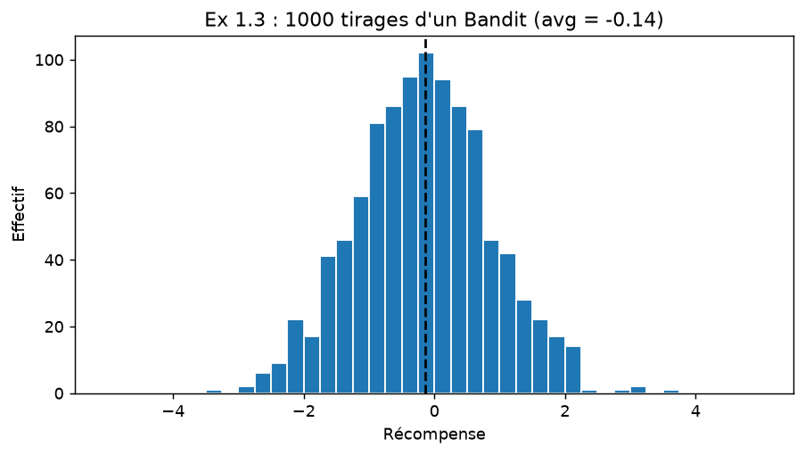
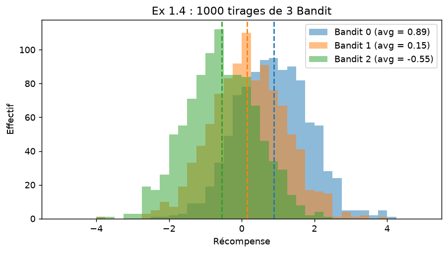
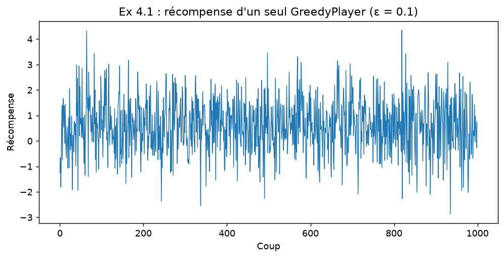
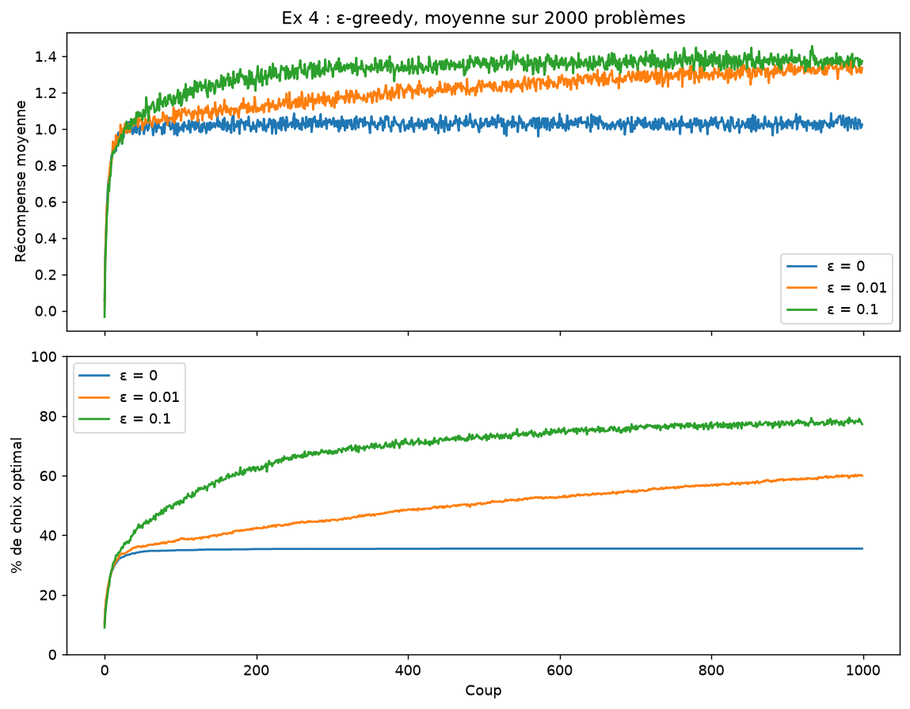
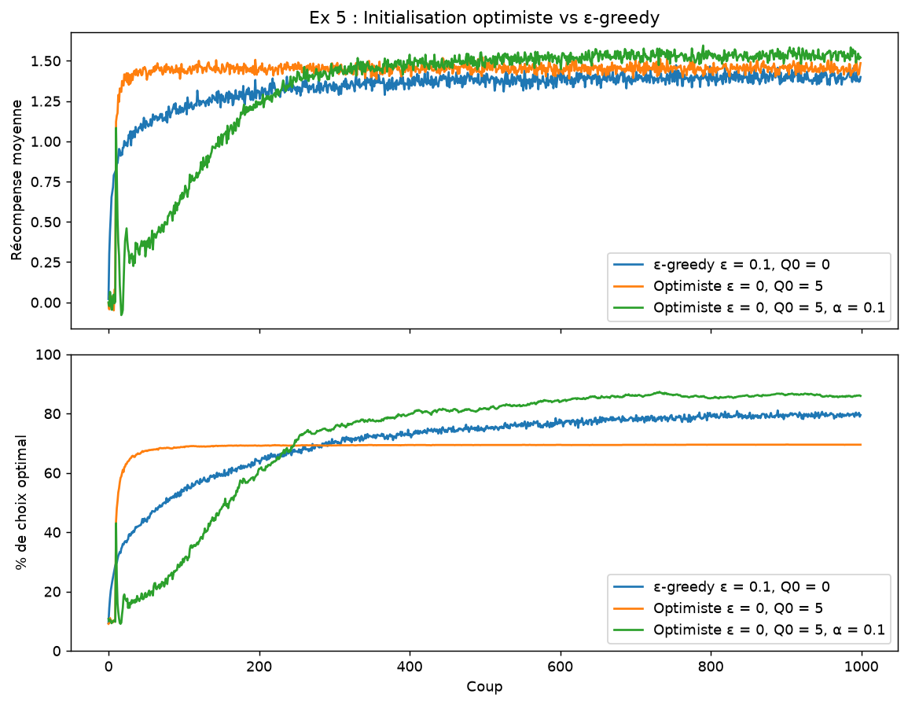
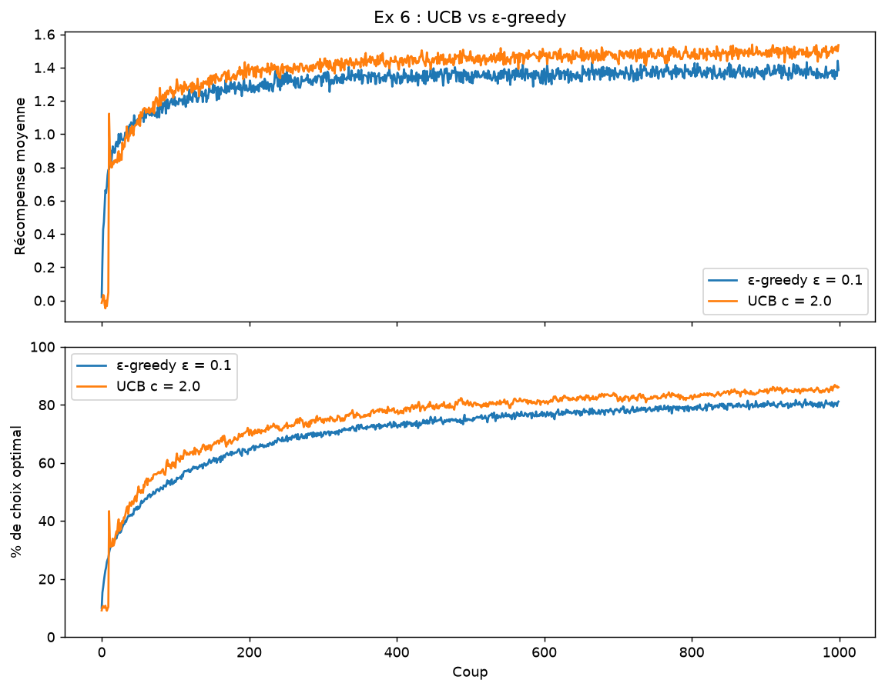
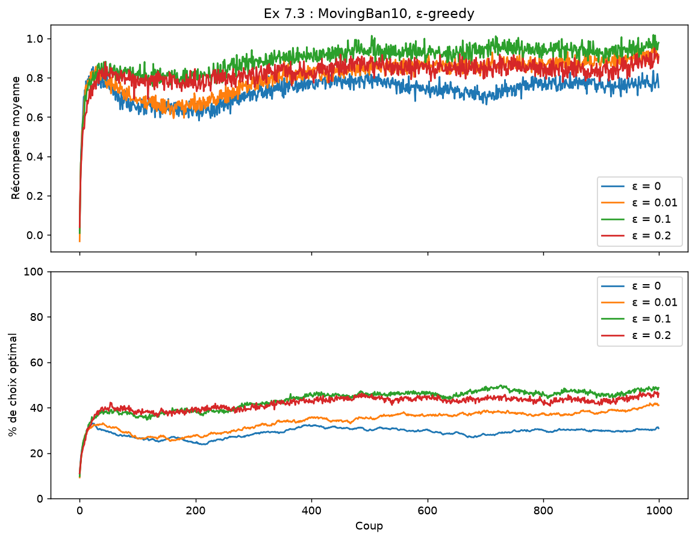
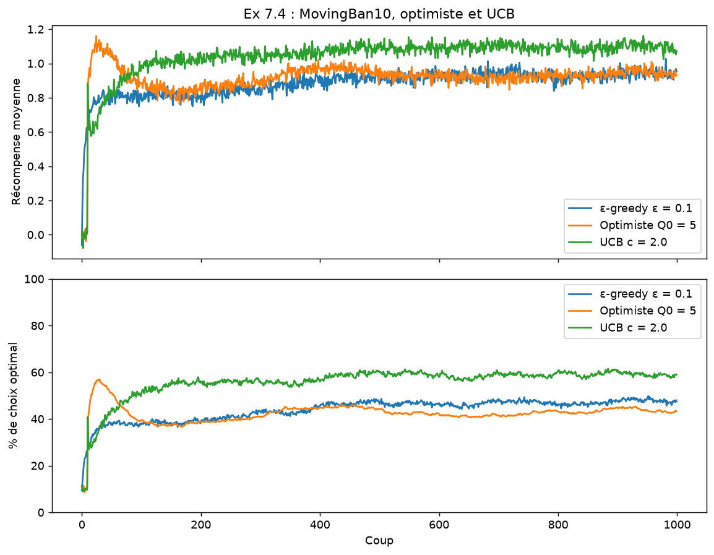
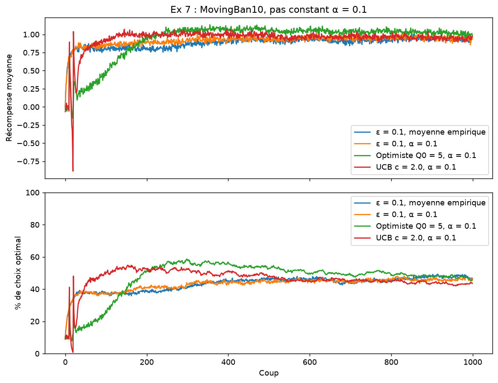

# Rapport TP bandit à N bras : apprentissage par renforcement

**Membres du groupe** : AGANZE LWABOSHI Moïse, Gédéon MUTIKANGA, Jonas AMOZIGH.

**Dépôt GitHub** : <https://github.com/IrALm/tp-apprentissage-par-renforcement>

Nous avons réalisé le TP 1 - bandit manchot : nous avons implémenté un
bandit à 10 bras et trois stratégies (ε-greedy, initialisation optimiste,
UCB), que nous avons comparées en stationnaire puis en non-stationnaire
(bonus). Chaque question est numérotée comme dans le sujet ; sous chaque
réponse, nous reproduisons le code qui y répond.

## Organisation du travail

Nous avons travaillé ensemble sur **toutes** les questions, au cours de
séances communes, sans découper le TP en parties individuelles. Pour
chaque exercice, nous avons :

- discuté ensemble des choix de conception (par exemple, faire avancer
  tous les bras du `MovingBan10` à chaque coup, ou comparer les stratégies
  sur des copies du même problème) ;
- écrit et testé le code ensemble, en prenant la main à tour de rôle ;
- analysé les courbes et rédigé les interprétations ensemble, puis relu
  ensemble l'intégralité du rapport.

Nous avons donc tous traité les mêmes difficultés : implémentation des
classes, expériences sur 2000 problèmes, et interprétation des résultats.
Comme le demande le sujet, chaque question indique qui a fait quoi (code,
graphiques, rédaction).

## Structure du projet

| Fichier | Contenu |
|---|---|
| `bandit.py` | Exercices 1, 2, 7.1-7.2 : `Bandit`, `Ban10`, `MovingBandit`, `MovingBan10`. |
| `players.py` | Exercices 3, 5, 6 : `GreedyPlayer`, `OptimistGreedyPlayer`, `UCBGreedyPlayer`. |
| `experiments.py` | Exercice 4 : `run_experiment` (2000 problèmes joués étape par étape) et tracé des courbes. |
| `main.py` | Une commande par exercice ; les figures sont écrites dans `figures/`. |

Dépendances : Python 3, `numpy`, `matplotlib` (`pip install numpy matplotlib`).

Imports utilisés dans les extraits ci-dessous :

```python
# bandit.py / players.py
import math
import random

# experiments.py
import copy
import os
import matplotlib.pyplot as plt
import numpy as np

# main.py
from bandit import Ban10, Bandit, MovingBan10
from experiments import plot_results, run_experiment, save
from players import GreedyPlayer, OptimistGreedyPlayer, UCBGreedyPlayer
```

## Reproduire les résultats

```bash
python main.py all          # tous les exercices (~2 min), graine 42
python main.py ex4          # un exercice seul
python main.py ex3 --verbose          # affiche les 1000 coups
python main.py ex6 --c 1 --runs 500   # options : --runs --steps --eps --c --seed
```

Tous les chiffres ci-dessous viennent de `python main.py all` (graine 42,
2000 problèmes × 1000 coups). « Fin » = moyenne sur les 100 derniers coups.
La graine rend les résultats reproductibles. Lancer un exercice seul donne
des chiffres légèrement différents, car la séquence aléatoire n'est plus
la même.

**Précision des chiffres.** Chaque exercice tire ses propres 2000
problèmes, donc une même stratégie n'a pas exactement le même score d'un
exercice à l'autre : par exemple, ε = 0.1 donne 77.8 %, 79.5 % ou 80.2 % de
choix optimaux aux exercices 4, 5 et 6. Ces petits écarts (2-3 points)
viennent du hasard, pas du code. Nous ne comparons donc que les écarts
plus grands. Dans un même exercice, toutes les stratégies jouent sur les
mêmes problèmes (question 5.3).

---

## Exercice 1 : le bandit manchot

**1.1** Le constructeur de `Bandit` tire `avg` suivant une gaussienne de
moyenne 0 et de variance 1.

*Code et rédaction : Moïse, Gédéon et Jonas, ensemble.*

```python
class Bandit:
    """Un bras de machine à sous : récompense ~ N(avg, 1), avec
    avg ~ N(0, 1) tiré une fois pour toutes à la construction (Exercice 1)."""

    def __init__(self):
        self.avg = random.gauss(0, 1)
```

**1.2** `play()` renvoie un tirage gaussien centré sur `self.avg`, de
variance 1.

*Code et rédaction : Moïse, Gédéon et Jonas, ensemble.*

```python
    # (méthode de Bandit)
    def play(self):
        return random.gauss(self.avg, 1)
```

**1.3** 1000 tirages d'un même bandit : l'histogramme a la forme en cloche
d'une gaussienne, centrée sur `avg` (ligne pointillée), d'écart-type ≈ 1.
Nous obtenons bien une distribution normale.

*Code, graphique et rédaction : Moïse, Gédéon et Jonas, ensemble.*

```python
def cmd_ex1(args):
    """Exercice 1.3-1.4 : histogrammes de 1000 tirages, 1 puis 3 bandits."""
    bins = np.linspace(-5, 5, 41)
    fig, ax = plt.subplots(figsize=(8, 4))
    bandit = Bandit()
    ax.hist([bandit.play() for _ in range(1000)], bins=bins, edgecolor="white")
    ax.axvline(bandit.avg, color="black", linestyle="--")
    ax.set_title(f"Ex 1.3 : 1000 tirages d'un Bandit (avg = {bandit.avg:.2f})")
    ax.set_xlabel("Récompense")
    ax.set_ylabel("Effectif")
    save(fig, "ex1_3_un_bandit.png")
    print(f"  Bandit : avg = {bandit.avg:.3f}")
    # ... suite : question 1.4
```



**1.4** Trois bandits : trois cloches de même largeur mais de pics
différents, chacun centré sur son propre `avg`. Nous obtenons bien trois
distributions d'espérances différentes, et les moyennes empiriques
retrouvent les vraies moyennes :

| | `avg` | moyenne de 1000 tirages |
|---|---|---|
| Bandit 0 | 0.889 | 0.871 |
| Bandit 1 | 0.153 | 0.189 |
| Bandit 2 | −0.550 | −0.573 |

*Code, graphique et rédaction : Moïse, Gédéon et Jonas, ensemble.*

```python
    # (suite de cmd_ex1)
    fig, ax = plt.subplots(figsize=(8, 4))
    for i in range(3):
        b = Bandit()
        samples = [b.play() for _ in range(1000)]
        ax.hist(samples, bins=bins, color=f"C{i}", alpha=0.5,
                label=f"Bandit {i} (avg = {b.avg:.2f})")
        ax.axvline(b.avg, color=f"C{i}", linestyle="--")
        print(f"  Bandit {i} : avg = {b.avg:.3f}, moyenne empirique = {np.mean(samples):.3f}")
    ax.set_title("Ex 1.4 : 1000 tirages de 3 Bandit")
    ax.set_xlabel("Récompense")
    ax.set_ylabel("Effectif")
    ax.legend()
    save(fig, "ex1_4_trois_bandits.png")
```



Les distributions se recouvrent largement : un seul tirage ne suffit pas à
savoir quel bras est le meilleur. C'est tout l'enjeu du problème.

## Exercice 2 : le Ban10

**2.1** Le constructeur de `Ban10` instancie 10 `Bandit` et les stocke dans
la liste `self.bandits`. L'attribut de classe `bandit_class` permet de
réutiliser `Ban10` à l'exercice 7 avec des bandits mobiles, sans dupliquer
le code.

*Code et rédaction : Moïse, Gédéon et Jonas, ensemble.*

```python
class Ban10:
    """Bandit à 10 bras (Exercice 2)."""

    bandit_class = Bandit

    def __init__(self, n=10):
        self.bandits = [self.bandit_class() for _ in range(n)]
        self.best_action = self._compute_best_action()
```

**2.2** L'attribut `best_action`, calculé dans le constructeur, est le
numéro du bandit de plus grand `avg`.

*Code et rédaction : Moïse, Gédéon et Jonas, ensemble.*

```python
    # (méthode de Ban10)
    def _compute_best_action(self):
        avgs = [b.avg for b in self.bandits]
        return avgs.index(max(avgs))
```

**2.3** `play(action)` prend le numéro du bras (0 à 9) et renvoie la
récompense de ce bras.

*Code et rédaction : Moïse, Gédéon et Jonas, ensemble.*

```python
    # (méthode de Ban10)
    def play(self, action):
        return self.bandits[action].play()
```

Exemple (`python main.py ex2`) :

```python
def cmd_ex2(args):
    """Exercice 2 : affiche les moyennes d'un Ban10 et son meilleur bras."""
    ban = Ban10()
    for i, b in enumerate(ban.bandits):
        mark = "  <- meilleur" if i == ban.best_action else ""
        print(f"  bras {i} : avg = {b.avg:+.3f}{mark}")
    print(f"  best_action = {ban.best_action}, play(best_action) = "
          f"{ban.play(ban.best_action):+.3f}")
```

```
bras 0 : avg = +0.998
...
bras 6 : avg = +1.183
...
bras 9 : avg = +1.786  <- meilleur
best_action = 9
```

## Exercice 3 : algorithme ε-greedy

**3.1** Le constructeur de `GreedyPlayer` prend `n` (nombre d'actions) et
`eps` (valeur de ε) et les stocke dans des attributs. Le paramètre
optionnel `alpha` (pas constant) ne sert qu'aux exercices 5 et 7.

*Code et rédaction : Moïse, Gédéon et Jonas, ensemble.*

```python
class GreedyPlayer:
    """Joueur epsilon-greedy (Exercice 3).

    `alpha` : pas d'apprentissage. Par défaut (None) on utilise la moyenne
    empirique, Q += (r - Q) / N, adaptée au cas stationnaire. Un `alpha`
    constant donne plus de poids aux récompenses récentes, utile pour
    l'Exercice 7 (non-stationnaire)."""

    def __init__(self, n=10, eps=0.1, alpha=None):
        self.n = n
        self.eps = eps
        self.alpha = alpha
        self.action_values = [0.0] * n   # Q
        self.eval_count = [0] * n        # N
        self.steps = 0                   # nombre d'appels à reward
```

**3.2** Dans le même constructeur, Q et N sont initialisés à 0 sous les
noms `action_values` (estimation de la valeur de chaque action) et
`eval_count` (nombre de fois où chaque action a été choisie). L'attribut
`steps` compte les appels à `reward`, ce qui servira pour UCB (6.2).

*Code et rédaction : Moïse, Gédéon et Jonas, ensemble.*

```python
        self.action_values = [0.0] * n   # Q
        self.eval_count = [0] * n        # N
```

**3.3** `get_action()` ne prend aucun paramètre et renvoie le numéro du
levier à actionner sur le `Ban10`. Sa version complète, construite aux
questions 3.4 et 3.7 :

*Code et rédaction : Moïse, Gédéon et Jonas, ensemble.*

```python
    # (méthode de GreedyPlayer)
    def get_action(self):
        explore = random.random() < self.eps
        if explore:
            return self._random_action()
        return self._greedy_action()
```

**3.4** Dans `get_action`, nous tirons une valeur uniforme entre 0 et 1 avec
`random.random()` et la comparons à ε : `explore` vaut `True` si la valeur
est inférieure à `eps`, `False` sinon.

*Code et rédaction : Moïse, Gédéon et Jonas, ensemble.*

```python
        explore = random.random() < self.eps
```

**3.5** `_greedy_action` renvoie l'action de plus grande valeur estimée.
En cas d'égalité, `_argmax` choisit au hasard parmi les actions ex aequo.
C'est important au début : tous les Q valent 0, et un `argmax` classique
choisirait toujours le bras 0.

*Code et rédaction : Moïse, Gédéon et Jonas, ensemble.*

```python
    # (méthodes de GreedyPlayer)
    def _greedy_action(self):
        return self._argmax(self.action_values)

    @staticmethod
    def _argmax(values):
        """Indice de la plus grande valeur, égalités départagées au hasard."""
        best = max(values)
        return random.choice([i for i, v in enumerate(values) if v == best])
```

**3.6** `_random_action` renvoie une action tirée uniformément parmi les
`n` actions.

*Code et rédaction : Moïse, Gédéon et Jonas, ensemble.*

```python
    # (méthode de GreedyPlayer)
    def _random_action(self):
        return random.randrange(self.n)
```

**3.7** `get_action` appelle `_random_action` si `explore` vaut `True`,
sinon `_greedy_action`, et renvoie l'action obtenue (code complet à la
question 3.3) :

*Code et rédaction : Moïse, Gédéon et Jonas, ensemble.*

```python
        if explore:
            return self._random_action()
        return self._greedy_action()
```

**3.8** `reward(action, r)` met à jour N et Q pour l'action jouée, par
moyenne incrémentale :

```
N(a) <- N(a) + 1
Q(a) <- Q(a) + (r - Q(a)) / N(a)
```

Le paramètre optionnel `alpha` remplace `1/N(a)` par un pas constant. Il
n'est utilisé qu'aux exercices 5 (comparaison) et 7.

*Code et rédaction : Moïse, Gédéon et Jonas, ensemble.*

```python
    # (méthode de GreedyPlayer)
    def reward(self, action, reward):
        self.steps += 1
        self.eval_count[action] += 1
        step_size = self.alpha if self.alpha is not None else 1 / self.eval_count[action]
        self.action_values[action] += step_size * (reward - self.action_values[action])
```

**3.9** Dans le code principal (`cmd_ex3`), nous créons un `Ban10` et un
`GreedyPlayer` pour 10 actions, puis enchaînons `get_action`,
`Ban10.play` et `reward` :

*Code et rédaction : Moïse, Gédéon et Jonas, ensemble.*

```python
    ban = Ban10()
    player = GreedyPlayer(10, args.eps)
    action = player.get_action()
    reward = ban.play(action)
    player.reward(action, reward)
```

**3.10** Ces trois appels sont placés dans une boucle de 1000 itérations
(`args.steps` vaut 1000 par défaut) :

*Code et rédaction : Moïse, Gédéon et Jonas, ensemble.*

```python
def cmd_ex3(args):
    """Exercice 3.9-3.11 + 4.1 : un joueur epsilon-greedy, 1000 coups."""
    ban = Ban10()
    player = GreedyPlayer(10, args.eps)
    rewards = []
    n_optimal = 0
    for t in range(args.steps):
        action = player.get_action()
        reward = ban.play(action)
        player.reward(action, reward)
        rewards.append(reward)
        optimal = action == ban.best_action
        n_optimal += optimal
        # ... affichage : question 3.11
```

**3.11** À chaque itération, nous affichons la récompense et si le choix
était optimal (`action == ban.best_action`). Par défaut, seuls les 20
premiers et les 5 derniers coups s'affichent ; `--verbose` affiche les
1000.

*Code et rédaction : Moïse, Gédéon et Jonas, ensemble.*

```python
        # (dans la boucle de cmd_ex3)
        if args.verbose or t < 20 or t >= args.steps - 5:
            print(f"  coup {t:4d} : bras {action}  récompense {reward:+.3f}  "
                  f"{'optimal' if optimal else '-'}")
        elif t == 20:
            print("  ...")
    # (après la boucle)
    print(f"  Meilleur bras : {ban.best_action}. Choix optimal sur "
          f"{n_optimal}/{args.steps} coups.")
    print(f"  Q estimés : {[round(q, 2) for q in player.action_values]}")
    print(f"  Vrais avg : {[round(b.avg, 2) for b in ban.bandits]}")
```

```
coup    0 : bras 8  récompense -1.246  -
coup    1 : bras 9  récompense -0.652  -
coup    2 : bras 7  récompense -1.809  -
coup    3 : bras 2  récompense -1.080  -
coup    4 : bras 3  récompense +0.581  optimal
coup    5 : bras 3  récompense +1.388  optimal
...
Choix optimal sur 905/1000 coups.
```

Nous observons le comportement greedy au démarrage : tout est à 0, et un
bras qui donne une récompense négative passe sous 0. Le joueur essaie donc
d'autres bras jusqu'à en trouver un positif (ici le bras 3, le meilleur),
puis il s'y tient.

## Exercice 4 : graphiques simples

**4.1** La récompense d'un seul joueur au cours des 1000 itérations est
très bruitée : chaque tirage a une variance de 1, du même ordre que les
écarts entre bras. Nous ne voyons aucune tendance.

*Code, graphique et rédaction : Moïse, Gédéon et Jonas, ensemble.*

```python
    # (fin de cmd_ex3) : récompense du joueur à chaque coup
    fig, ax = plt.subplots(figsize=(9, 4))
    ax.plot(rewards, linewidth=0.8)
    ax.set_title(f"Ex 4.1 : récompense d'un seul GreedyPlayer (ε = {args.eps})")
    ax.set_xlabel("Coup")
    ax.set_ylabel("Récompense")
    save(fig, "ex4_1_un_joueur.png")
```



**4.2** `run_experiment` crée 2000 couples (`Ban10`, joueur) dans un
tableau et les fait jouer **étape par étape** : les 2000 jouent leur coup
1, puis leur coup 2, etc. (boucle sur `t` à l'extérieur, boucle sur les
parties à l'intérieur).

*Code et rédaction : Moïse, Gédéon et Jonas, ensemble.*

```python
def run_experiment(player_factories, ban_class, n_runs=2000, n_steps=1000):
    """Fait jouer chaque stratégie sur `n_runs` problèmes, étape par étape
    (les n_runs instances jouent leur 1er coup, puis leur 2e, etc.,
    Exercice 4.2).

    `player_factories` : {label: fonction sans argument -> Player}.
    Pour chaque problème on crée UN bandit, puis chaque stratégie joue sur
    une copie de ce même bandit (mêmes moyennes de départ) : les
    stratégies sont comparées sur exactement les mêmes problèmes
    (Exercice 5.3). La copie est nécessaire car un MovingBan10 évolue à
    chaque coup : partager l'objet ferait avancer son temps deux fois.

    Renvoie {label: (récompense_moyenne[t], %_optimal[t])}."""
    bans = [ban_class() for _ in range(n_runs)]
    results = {}
    for label, make_player in player_factories.items():
        games = [(copy.deepcopy(ban), make_player()) for ban in bans]
        rewards = np.zeros(n_steps)
        optimal = np.zeros(n_steps)
        for t in range(n_steps):
            reward_sum = 0.0
            optimal_count = 0
            for ban, player in games:
                best = ban.best_action  # lu avant le coup (MovingBan10 bouge)
                action = player.get_action()
                reward = ban.play(action)
                player.reward(action, reward)
                reward_sum += reward
                optimal_count += action == best
            rewards[t] = reward_sum / n_runs
            optimal[t] = 100 * optimal_count / n_runs
        results[label] = (rewards, optimal)
        print(f"  {label:<28} récompense moy. (100 derniers coups) = "
              f"{rewards[-100:].mean():.3f}   % optimal = {optimal[-100:].mean():.1f}%")
    return results
```

**4.3** Au lieu de la récompense d'un seul joueur, nous traçons à chaque
coup la moyenne des récompenses des 2000 joueurs (`rewards[t]` ci-dessus),
dans le panneau du haut de `plot_results` :

*Code, graphique et rédaction : Moïse, Gédéon et Jonas, ensemble.*

```python
            rewards[t] = reward_sum / n_runs      # (dans run_experiment)
```

```python
def plot_results(results, title, filename):
    """Trace la récompense moyenne (en haut) et le % de choix optimal (en bas)."""
    fig, (ax_r, ax_o) = plt.subplots(2, 1, figsize=(9, 7), sharex=True)
    for label, (rewards, optimal) in results.items():
        ax_r.plot(rewards, label=label)
        ax_o.plot(optimal, label=label)
    ax_r.set_title(title)
    ax_r.set_ylabel("Récompense moyenne")
    ax_o.set_ylabel("% de choix optimal")
    ax_o.set_xlabel("Coup")
    ax_o.set_ylim(0, 100)
    ax_r.legend()
    ax_o.legend()
    fig.tight_layout()
    return save(fig, filename)
```

**4.4** À chaque coup, nous comptons aussi les joueurs qui ont choisi
`best_action` et traçons ce pourcentage dans le panneau du bas de
`plot_results` :

*Code, graphique et rédaction : Moïse, Gédéon et Jonas, ensemble.*

```python
                optimal_count += action == best        # (dans run_experiment)
            optimal[t] = 100 * optimal_count / n_runs
```

**4.5** Même expérience pour ε = 0, 0.01 et 0.1, les trois courbes sur le
même graphique de récompense moyenne et sur le même graphique de
pourcentage d'optimalité :

*Code, graphique et rédaction : Moïse, Gédéon et Jonas, ensemble.*

```python
def cmd_ex4(args):
    """Exercice 4.2-4.5 : moyenne sur 2000 problèmes, eps = 0, 0.01, 0.1."""
    results = run_experiment(
        {f"ε = {eps}": (lambda eps=eps: GreedyPlayer(10, eps)) for eps in (0, 0.01, 0.1)},
        Ban10, args.runs, args.steps)
    plot_results(results, f"Ex 4 : ε-greedy, moyenne sur {args.runs} problèmes",
                 "ex4_epsilon_greedy.png")
```



| ε | récompense (fin) | % optimal (fin) |
|---|---|---|
| 0 | 1.03 | 35.5 % |
| 0.01 | 1.33 | 59.4 % |
| 0.1 | 1.38 | 77.8 % |

**4.6 Interprétation.**

*Analyse et rédaction : Moïse, Gédéon et Jonas, ensemble.*

*Comportement initial.* Au coup 1, tous les Q valent 0 et le choix est
aléatoire : la récompense moyenne vaut ≈ 0 et 10 % des choix sont optimaux.
Les trois courbes montent ensuite très vite pendant ~20 coups, car le
joueur abandonne les bras qui donnent du négatif. ε = 0 est même un peu
devant au tout début, puisqu'il ne « gaspille » aucun coup en
exploration.

*Comportement asymptotique.*
- **ε = 0** plafonne dès le coup ~50, à 1.03 et 35 % de choix optimaux. Il
  se fige sur le premier bras dont l'estimation reste positive. Les autres
  bras, qui n'ont jamais été essayés ou ont été sous-estimés sur un
  mauvais tirage, ne sont jamais réévalués.
- **ε = 0.1** explore beaucoup : il trouve le meilleur bras plus vite et
  domine sur 1000 coups. Mais il continue de jouer au hasard 10 % du temps,
  donc il ne peut pas dépasser 1 − ε + ε/10 = **91 %** de choix optimaux.
- **ε = 0.01** apprend plus lentement (sa courbe monte encore au coup 1000)
  mais son plafond théorique est de **99.1 %**. Sur un horizon assez long,
  il finirait par dépasser ε = 0.1.

C'est le compromis exploration / exploitation : explorer coûte à court
terme mais évite de rester bloqué sur un mauvais bras.

## Exercice 5 : initialisation optimiste

**5.1** `OptimistGreedyPlayer` dérive de `GreedyPlayer` : il hérite de
`get_action`, `_greedy_action`, `_random_action` et `reward`.

*Code et rédaction : Moïse, Gédéon et Jonas, ensemble.*

```python
class OptimistGreedyPlayer(GreedyPlayer):
    """Greedy avec des estimations initiales optimistes, Q0 = 5
    (Exercice 5). Par défaut eps = 0 : c'est l'optimisme seul qui pousse
    à explorer."""
```

**5.2** Son constructeur appelle celui de `GreedyPlayer`, puis initialise
Q à 5. Par défaut ε = 0 : c'est l'optimisme seul qui fait explorer.

*Code et rédaction : Moïse, Gédéon et Jonas, ensemble.*

```python
    # (constructeur de OptimistGreedyPlayer)
    def __init__(self, n=10, eps=0.0, initial_value=5.0, alpha=None):
        super().__init__(n, eps, alpha)
        self.action_values = [float(initial_value)] * n
```

**5.3** Nous comparons `OptimistGreedyPlayer` (Q0 = 5, ε = 0) et
`GreedyPlayer` (ε = 0.1). Comme le demande le sujet, les deux joueurs
jouent sur le même `Ban10`. `run_experiment` (question 4.2) crée **un**
`Ban10` par problème et donne à chaque stratégie une copie (`deepcopy`) de
cet objet, avec les mêmes moyennes : les deux joueurs sont évalués sur
exactement les mêmes 2000 problèmes. Nous copions l'objet au lieu de le
partager pour que deux joueurs ne fassent pas avancer le même bandit,
ce qui serait faux pour le `MovingBan10` de l'exercice 7. Les lignes
concernées :

*Code, graphique et rédaction : Moïse, Gédéon et Jonas, ensemble.*

```python
    bans = [ban_class() for _ in range(n_runs)]          # un problème par run
    for label, make_player in player_factories.items():
        games = [(copy.deepcopy(ban), make_player()) for ban in bans]
```

Comparaison lancée par `python main.py ex5`. Nous ajoutons une troisième
courbe (extension) avec un pas constant α = 0.1 :

```python
def cmd_ex5(args):
    """Exercice 5 : optimiste (Q0 = 5, eps = 0) vs eps-greedy 0.1."""
    results = run_experiment({
        "ε-greedy ε = 0.1, Q0 = 0": lambda: GreedyPlayer(10, 0.1),
        "Optimiste ε = 0, Q0 = 5": lambda: OptimistGreedyPlayer(10, 0.0, 5.0),
        # Avec la moyenne empirique, Q0 est entièrement oublié au 1er tirage
        # (pas de 1/1) ; avec un pas constant il s'estompe progressivement.
        "Optimiste ε = 0, Q0 = 5, α = 0.1":
            lambda: OptimistGreedyPlayer(10, 0.0, 5.0, alpha=0.1),
    }, Ban10, args.runs, args.steps)
    plot_results(results, "Ex 5 : Initialisation optimiste vs ε-greedy",
                 "ex5_optimiste.png")
```



| Joueur | récompense (fin) | % optimal (fin) |
|---|---|---|
| ε-greedy ε = 0.1, Q0 = 0 | 1.40 | 79.5 % |
| Optimiste ε = 0, Q0 = 5 (moyenne empirique) | 1.45 | 69.5 % |
| Optimiste ε = 0, Q0 = 5, α = 0.1 (extension) | **1.54** | **86.1 %** |

**5.4 Interprétation.**

*Analyse et rédaction : Moïse, Gédéon et Jonas, ensemble.*

*Comportement initial.* Q0 = 5 est bien au-dessus de toute récompense
réaliste. Chaque tirage « déçoit » donc et fait baisser l'estimation du
bras joué sous celle des bras pas encore essayés. Le joueur essaie ainsi
systématiquement les 10 bras pendant les 10 premiers coups : la récompense
reste ≈ 0 et 10 % des choix sont optimaux. Ensuite, il exploite les
estimations obtenues et monte beaucoup plus vite qu'ε-greedy (≈ 69 % de
choix optimaux dès le coup 50).

*Comportement asymptotique.* Avec la moyenne empirique, le premier pas vaut
1/N = 1/1 : **Q0 est entièrement oublié dès le premier tirage de chaque
bras** (Q devient la première récompense). Le joueur optimiste revient donc
à « essayer chaque bras une fois, puis greedy pur ». Il ne réexplore plus
jamais et se fige à 69.5 % de choix optimaux, avec une courbe parfaitement
plate. Sa récompense reste supérieure à celle d'ε-greedy (1.45 contre
1.40) : quand il se trompe, c'est en général sur un bras proche du
meilleur, et il ne perd pas 10 % de ses coups en hasard.

Avec un pas constant α = 0.1, Q0 = 5 s'efface plus lentement : chaque bras
est essayé plusieurs fois avant que son estimation descende. Le démarrage
est plus lent, mais le joueur finit meilleur : 86 % de choix optimaux
contre 80 % pour ε = 0.1. Limite de la méthode : elle n'explore qu'au
début, ce qui risque de poser problème en non-stationnaire (exercice 7).

## Exercice 6 : sélection Upper-Confidence-Bound

**6.1** `UCBGreedyPlayer` dérive de `GreedyPlayer` et prend un argument
supplémentaire `c` (degré d'exploration), stocké dans l'attribut `self.c`.

*Code et rédaction : Moïse, Gédéon et Jonas, ensemble.*

```python
class UCBGreedyPlayer(GreedyPlayer):
    """Sélection Upper-Confidence-Bound (Exercice 6) :

        A_t = argmax_a [ Q(a) + c * sqrt( ln t / N(a) ) ]

    où t est le nombre d'appels à `reward`. Une action jamais essayée
    (N(a) = 0) est considérée comme maximisante."""

    def __init__(self, n=10, c=2.0, eps=0.0, alpha=None):
        super().__init__(n, eps, alpha)
        self.c = c
```

**6.2** `_greedy_action` est surchargée pour appliquer la formule du cours :

```
A_t = argmax_a [ Q(a) + c * sqrt( ln t / N(a) ) ]
```

`t` est le nombre d'appels à `reward` (`self.steps`, incrémenté dans
`reward`, question 3.8). Une action jamais essayée (N(a) = 0) est
considérée comme maximisante : elle est choisie en priorité. Nous prenons
c = 2 et ε = 0. Seule `_greedy_action` est redéfinie : `get_action` et
`reward` sont hérités de `GreedyPlayer`.

*Code et rédaction : Moïse, Gédéon et Jonas, ensemble.*

```python
    # (méthode de UCBGreedyPlayer)
    def _greedy_action(self):
        untried = [i for i, count in enumerate(self.eval_count) if count == 0]
        if untried:
            return random.choice(untried)
        log_t = math.log(self.steps)
        scores = [q + self.c * math.sqrt(log_t / count)
                  for q, count in zip(self.action_values, self.eval_count)]
        return self._argmax(scores)
```

**6.3** Comparaison avec `GreedyPlayer` ε = 0.1 (`python main.py ex6`) :

*Code, graphique et rédaction : Moïse, Gédéon et Jonas, ensemble.*

```python
def cmd_ex6(args):
    """Exercice 6 : UCB (c = 2) vs eps-greedy 0.1."""
    results = run_experiment({
        "ε-greedy ε = 0.1": lambda: GreedyPlayer(10, 0.1),
        f"UCB c = {args.c}": lambda: UCBGreedyPlayer(10, args.c),
    }, Ban10, args.runs, args.steps)
    plot_results(results, "Ex 6 : UCB vs ε-greedy", "ex6_ucb.png")
```



| Joueur | récompense (fin) | % optimal (fin) |
|---|---|---|
| ε-greedy ε = 0.1 | 1.37 | 80.2 % |
| UCB c = 2 | **1.49** | **85.1 %** |

**6.4 Interprétation.**

*Analyse et rédaction : Moïse, Gédéon et Jonas, ensemble.*

*Comportement initial.* Pendant les 10 premiers coups, UCB essaie chaque
bras une fois (un bras jamais joué est prioritaire) : la récompense reste
≈ 0. Juste après, vers le coup 11, la courbe fait un pic : tous les bras
ont été joués une fois, donc UCB choisit celui qui a donné le meilleur
premier tirage, souvent le bon. Ensuite, le bonus de ce bras baisse et UCB
repart explorer les autres, d'où la redescente. Après quelques dizaines de
coups, UCB passe au-dessus d'ε-greedy.

*Comportement asymptotique.* UCB est meilleur (1.49 contre 1.37). Il
n'explore pas au hasard : il revient surtout sur les bras peu essayés ou
prometteurs, alors qu'ε-greedy continue de jouer des bras mauvais 10 % du
temps. Et comme le bonus diminue quand N augmente, UCB explore de moins en
moins. Inconvénient : il faut choisir la valeur de c.

## Exercice 7 (bonus) : problèmes non-stationnaires

**7.1** `MovingBandit` dérive de `Bandit`. Sa moyenne oscille selon
`avg(t) = centre + amplitude · sin(2π t / période + phase)` :
- min et max sont deux tirages N(0, 1), triés : ils donnent le centre et
  l'amplitude ;
- la période est tirée uniformément entre 100 et 500 coups ;
- la phase est aléatoire, pour que les bras ne partent pas tous du même
  point du sinus ;
- `avg` est mis à jour à chaque appel de `play()`.

*Code et rédaction : Moïse, Gédéon et Jonas, ensemble.*

```python
class MovingBandit(Bandit):
    """Bandit dont la moyenne oscille sinusoïdalement : elle avance d'un pas
    à chaque appel de `play` (Exercice 7.1). Période, min, max et phase
    sont tirés au hasard."""

    def __init__(self):
        low, high = sorted((random.gauss(0, 1), random.gauss(0, 1)))
        self.center = (low + high) / 2
        self.amplitude = (high - low) / 2
        self.period = random.uniform(100, 500)
        self.phase = random.uniform(0, 2 * math.pi)
        self.t = 0
        self._update_avg()

    def _update_avg(self):
        self.avg = self.center + self.amplitude * math.sin(
            2 * math.pi * self.t / self.period + self.phase)

    def step(self):
        """Fait avancer le temps d'un coup sans jouer."""
        self.t += 1
        self._update_avg()

    def play(self):
        reward = super().play()
        self.step()
        return reward
```

**7.2** `MovingBan10` dérive de `Ban10` et instancie des `MovingBandit` à
la place des `Bandit` (attribut `bandit_class`). Choix de conception : à
chaque coup, **tous** les bras avancent d'un pas (le bras joué via
`play`, les autres via `step`). Si seul le bras joué bougeait, un bras
délaissé resterait figé. La vraie difficulté disparaîtrait alors : un bras
ignoré qui devient le meilleur sans que l'agent le voie. `best_action` est
recalculé après chaque coup. Le « choix optimal » est jugé par rapport au
meilleur bras **au moment du coup**.

*Code et rédaction : Moïse, Gédéon et Jonas, ensemble.*

```python
class MovingBan10(Ban10):
    """Ban10 composé de MovingBandit (Exercice 7.2).

    Choix de conception : à chaque coup sur la machine, *tous* les bras
    avancent d'un pas (le bras joué via `play`, les autres via `step`).
    Sinon un bras jamais joué resterait figé, ce qui supprimerait
    justement la difficulté du non-stationnaire : un bras délaissé peut
    devenir le meilleur sans que l'agent le voie."""

    bandit_class = MovingBandit

    def play(self, action):
        for i, bandit in enumerate(self.bandits):
            if i != action:
                bandit.step()
        reward = self.bandits[action].play()
        self.best_action = self._compute_best_action()
        return reward
```

**7.3** Différentes valeurs de ε :

*Code, graphique et rédaction : Moïse, Gédéon et Jonas, ensemble.*

```python
# début de cmd_ex7 (main.py)
    print(" 7.3 : différentes valeurs de ε (moyenne empirique)")
    results = run_experiment(
        {f"ε = {eps}": (lambda eps=eps: GreedyPlayer(10, eps)) for eps in (0, 0.01, 0.1, 0.2)},
        MovingBan10, args.runs, args.steps)
    plot_results(results, "Ex 7.3 : MovingBan10, ε-greedy", "ex7_3_epsilon.png")
```



| ε | récompense (fin) | % optimal (fin) |
|---|---|---|
| 0 | 0.77 | 30.0 % |
| 0.01 | 0.90 | 39.5 % |
| 0.1 | **0.95** | **46.9 %** |
| 0.2 | 0.87 | 44.4 % |

Tous les scores chutent par rapport au stationnaire (≈ 47 % de choix
optimaux au lieu de 78 %), car le meilleur bras change au fil du temps.
ε = 0 souffre le plus : sa récompense **baisse** entre les coups 50 et 200,
parce que le bras sur lequel il s'est figé descend sur son sinus et qu'il
ne le voit pas. Il faut explorer, mais sans excès : ε = 0.2 fait moins bien
que 0.1.

**7.4** Optimiste et UCB (moyenne empirique) :

*Code, graphique et rédaction : Moïse, Gédéon et Jonas, ensemble.*

```python
# suite de cmd_ex7 (main.py)
    print(" 7.4 : optimiste et UCB (moyenne empirique)")
    results = run_experiment({
        "ε-greedy ε = 0.1": lambda: GreedyPlayer(10, 0.1),
        "Optimiste Q0 = 5": lambda: OptimistGreedyPlayer(10, 0.0, 5.0),
        f"UCB c = {args.c}": lambda: UCBGreedyPlayer(10, args.c),
    }, MovingBan10, args.runs, args.steps)
    plot_results(results, "Ex 7.4 : MovingBan10, optimiste et UCB",
                 "ex7_4_optimiste_ucb.png")
```



| Joueur | récompense (fin) | % optimal (fin) |
|---|---|---|
| ε-greedy ε = 0.1 | 0.94 | 47.9 % |
| Optimiste Q0 = 5 | 0.95 | 43.9 % |
| UCB c = 2 | **1.10** | **59.0 %** |

- **L'initialisation optimiste** est très bonne au début (pic à ≈ 55 % vers
  le coup 30). Mais son exploration n'a lieu qu'une fois, au départ. Elle
  retombe ensuite au niveau d'ε-greedy, puis légèrement en dessous, quand
  les bras se mettent à bouger.
- **UCB** est le meilleur : le terme `ln t` augmente avec le temps alors que
  N(a) reste constant pour un bras délaissé. Le bonus de ce bras remonte
  donc progressivement, et UCB revient régulièrement vérifier les bras
  qu'il n'a pas joués depuis longtemps.

*Extension : pas constant α = 0.1.* En non-stationnaire, la théorie
recommande un pas constant, qui pondère davantage les récompenses
récentes (paramètre `alpha` de `GreedyPlayer.reward`, question 3.8) :

*Code, graphique et rédaction : Moïse, Gédéon et Jonas, ensemble.*

```python
# fin de cmd_ex7 (main.py)
    print(" 7 (extension) : pas constant α = 0.1 au lieu de la moyenne empirique")
    results = run_experiment({
        "ε = 0.1, moyenne empirique": lambda: GreedyPlayer(10, 0.1),
        "ε = 0.1, α = 0.1": lambda: GreedyPlayer(10, 0.1, alpha=0.1),
        "Optimiste Q0 = 5, α = 0.1": lambda: OptimistGreedyPlayer(10, 0.0, 5.0, alpha=0.1),
        f"UCB c = {args.c}, α = 0.1": lambda: UCBGreedyPlayer(10, args.c, alpha=0.1),
    }, MovingBan10, args.runs, args.steps)
    plot_results(results, "Ex 7 : MovingBan10, pas constant α = 0.1",
                 "ex7_alpha_constant.png")
```



| Joueur | récompense (fin) | % optimal (fin) |
|---|---|---|
| ε = 0.1, moyenne empirique | 0.94 | 47.8 % |
| ε = 0.1, α = 0.1 | 0.94 | 45.9 % |
| Optimiste Q0 = 5, α = 0.1 | **1.01** | 47.6 % |
| UCB c = 2, α = 0.1 | 0.95 | 43.3 % |

Le gain est faible, voire négatif, ce qui nous a surpris. Nos hypothèses :
- **ε-greedy** : avec ε = 0.1, chaque bras non choisi n'est rejoué qu'à
  peu près une fois tous les 100 coups. Son estimation est donc vite
  dépassée, quelle que soit la façon de faire la moyenne.
- **L'optimiste** profite un peu d'α, grâce à son exploration plus longue
  au départ (comme à l'exercice 5).
- **UCB** fait moins bien avec α : son bonus dépend du nombre total de
  tirages N, alors qu'avec α, Q ne tient compte que des derniers tirages.
  Le bonus ne correspond donc plus vraiment à l'incertitude de Q.

---

## Conclusion

*Rédaction : Moïse, Gédéon et Jonas, ensemble.*

Récapitulatif des stratégies (moyenne sur les 100 derniers coups, 2000
problèmes). Les chiffres viennent d'expériences différentes (exercices 4 à
7) : à 2-3 points près (voir « Précision des chiffres »), ils sont
comparables d'une ligne à l'autre.

| Stratégie | Stationnaire : récompense | Stationnaire : % optimal | Non-stationnaire : récompense | Non-stationnaire : % optimal |
|---|---|---|---|---|
| ε-greedy ε = 0 | 1.03 | 35.5 % | 0.77 | 30.0 % |
| ε-greedy ε = 0.1 | 1.38 | 77.8 % | 0.94 | 47.9 % |
| Optimiste Q0 = 5 | 1.45 | 69.5 % | 0.95 | 43.9 % |
| Optimiste Q0 = 5, α = 0.1 | **1.54** | **86.1 %** | 1.01 | 47.6 % |
| UCB c = 2 | 1.49 | 85.1 % | **1.10** | **59.0 %** |

Ce que nous retenons :

- **Explorer est indispensable.** Le greedy pur (ε = 0) se fige sur un bras
  souvent mauvais et finit dernier dans les deux cas.
- **La façon d'explorer compte plus que la quantité.** ε-greedy explore au
  hasard et reste plafonné. L'initialisation optimiste explore tout au
  début, très efficacement, mais plus ensuite. UCB dirige son exploration
  vers les bras incertains.
- **En stationnaire**, l'optimiste avec α = 0.1 et UCB sont les meilleurs
  et au coude à coude.
- **En non-stationnaire**, UCB est nettement le plus robuste, car son bonus
  le ramène vers les bras délaissés. Les méthodes qui n'explorent qu'au
  début perdent leur avance quand les bras bougent.

---

## Annexe : code commun

Point d'entrée `main.py` (une commande par exercice, graine fixée) :

```python
COMMANDS = {"ex1": cmd_ex1, "ex2": cmd_ex2, "ex3": cmd_ex3, "ex4": cmd_ex4,
            "ex5": cmd_ex5, "ex6": cmd_ex6, "ex7": cmd_ex7}


def main():
    parser = argparse.ArgumentParser(description="TP bandit à N bras")
    parser.add_argument("command", choices=[*COMMANDS, "all"])
    parser.add_argument("--runs", type=int, default=2000, help="nombre de problèmes (défaut 2000)")
    parser.add_argument("--steps", type=int, default=1000, help="coups par problème (défaut 1000)")
    parser.add_argument("--eps", type=float, default=0.1, help="ε pour ex3 (défaut 0.1)")
    parser.add_argument("--c", type=float, default=2.0, help="c pour UCB (défaut 2)")
    parser.add_argument("--seed", type=int, default=42, help="graine aléatoire (défaut 42)")
    parser.add_argument("--verbose", action="store_true", help="ex3 : afficher les 1000 coups")
    args = parser.parse_args()

    random.seed(args.seed)
    names = list(COMMANDS) if args.command == "all" else [args.command]
    for name in names:
        print(f"== {name} ==")
        COMMANDS[name](args)
```

Sauvegarde des figures (`experiments.py`) :

```python
FIG_DIR = os.path.join(os.path.dirname(os.path.abspath(__file__)), "figures")

def save(fig, name):
    os.makedirs(FIG_DIR, exist_ok=True)
    path = os.path.join(FIG_DIR, name)
    fig.savefig(path, dpi=130, bbox_inches="tight")
    plt.close(fig)
    print(f"  -> {os.path.relpath(path)}")
    return path
```
