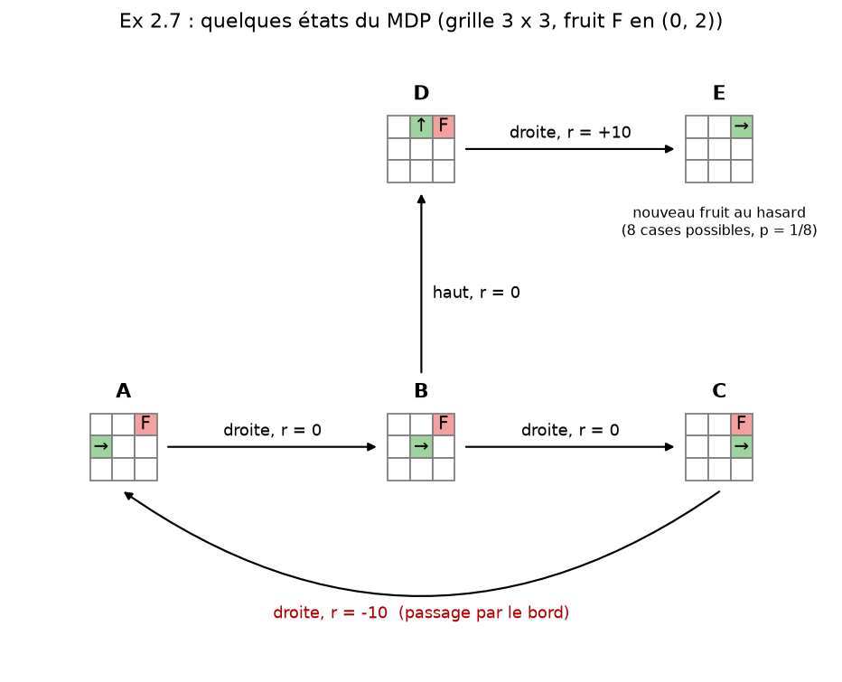
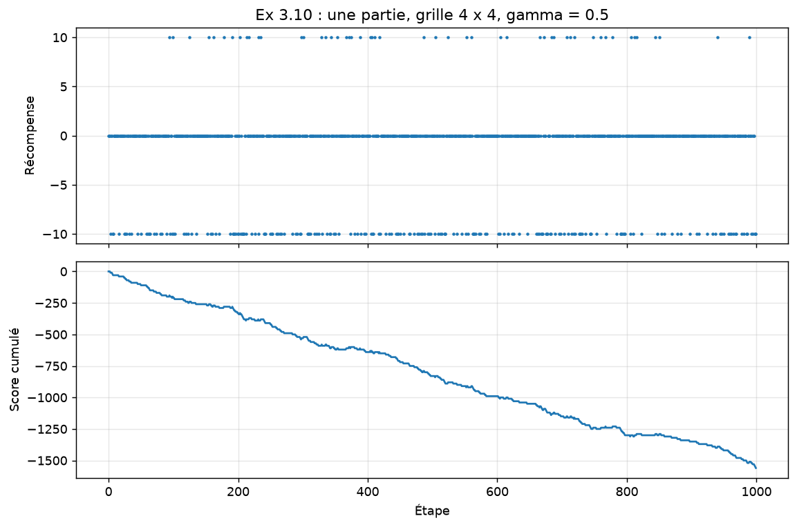
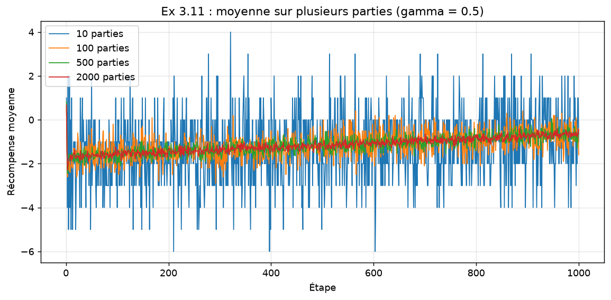
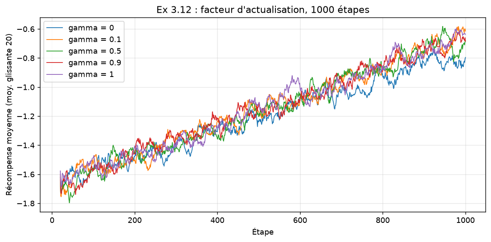
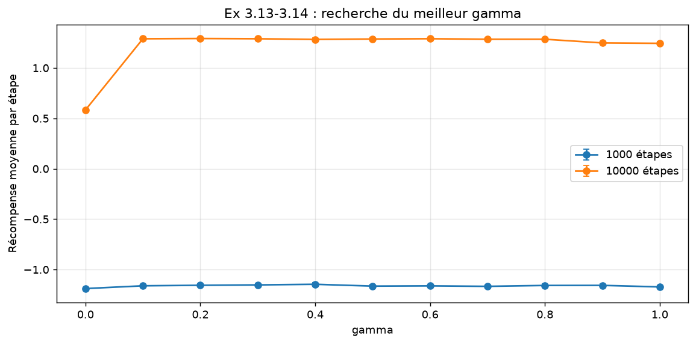
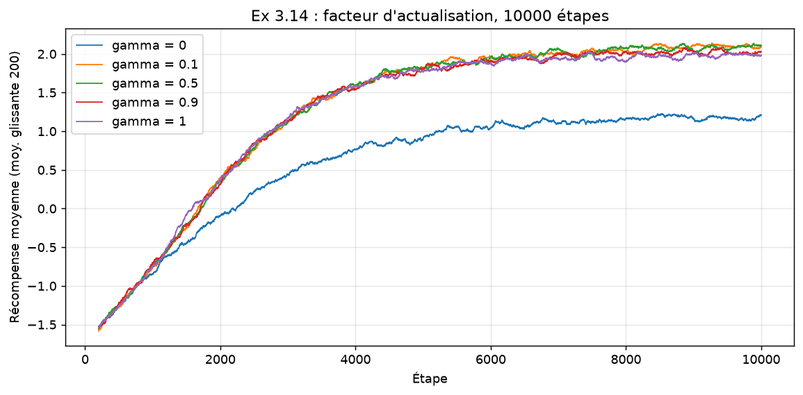
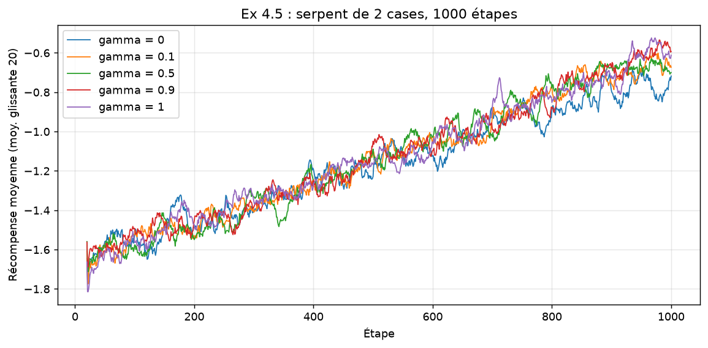
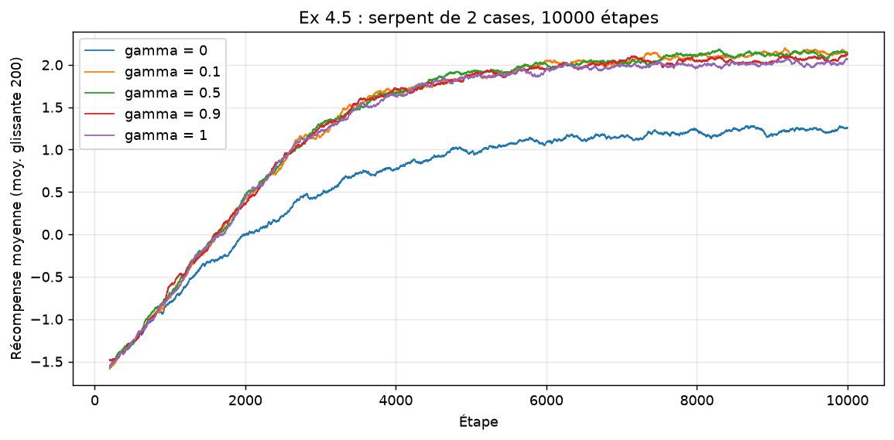
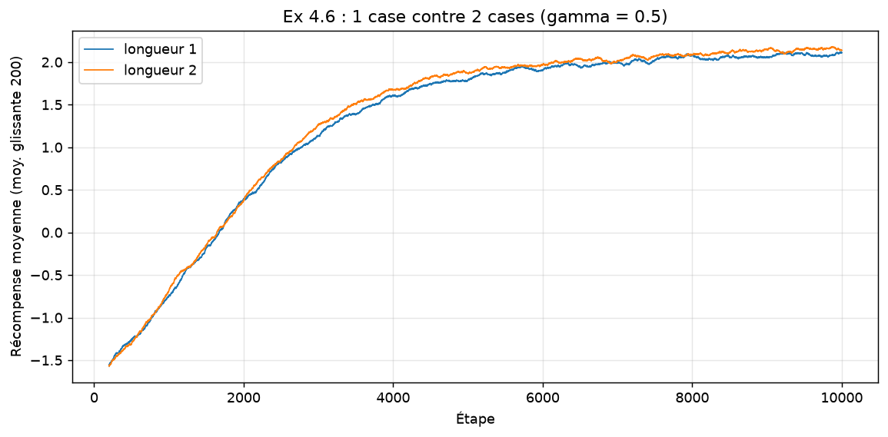
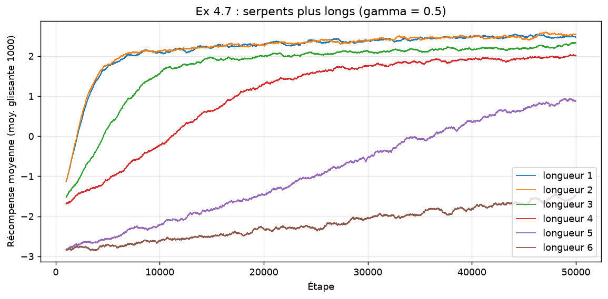

# Rapport TP MDP : Snake

**Membres du groupe** : AGANZE LWABOSHI Moïse, Gédéon MUTIKANGA, Jonas AMOZIGH.

**Dépôt GitHub** : <https://github.com/IrALm/tp-apprentissage-par-renforcement>

## Organisation du travail

Nous avons travaillé ensemble sur **toutes** les questions, au cours de
séances communes, sans découper le TP en parties individuelles. Pour
chaque exercice, nous avons :

- discuté ensemble de la modélisation (ce qui doit faire partie de l'état,
  taille de la grille pour les expériences) ;
- écrit et testé le code ensemble, en prenant la main à tour de rôle ;
- analysé les courbes et rédigé les réponses ensemble, puis relu ensemble
  l'intégralité du rapport.

Comme le demande le sujet, chaque question indique qui a fait quoi (code,
graphiques, rédaction).

## Structure du projet

| Fichier | Contenu |
|---|---|
| `snake.py` | Exercices 1, 3.1-3.2 et 4.3 : le jeu `ShortSnake`. |
| `player.py` | Exercice 3 : `GreedyPlayer` (Q-Learning, ε-greedy). |
| `experiments.py` | Exercices 3 et 4 : lancement de nombreuses parties et tracé des courbes. |
| `main.py` | Une commande par exercice ; les figures sont écrites dans `figures/`. |

Dépendances : Python 3, `numpy`, `matplotlib` (`pip install numpy matplotlib`).

Imports utilisés dans les extraits ci-dessous :

```python
# snake.py / player.py
import random
from snake import legal_actions          # dans player.py

# experiments.py
import os
import matplotlib.pyplot as plt
import numpy as np
from player import GreedyPlayer
from snake import ShortSnake

# main.py
from experiments import gamma_search, plot_curves, run, save
```

## Reproduire les résultats

```bash
python main.py all          # tous les exercices (~6 min), graine 42
python main.py ex3          # un exercice seul
python main.py ex3 --size 10          # options : --size --gamma --seed
```

Tous les chiffres ci-dessous viennent de `python main.py all` (graine 42).
Lancer un exercice seul donne des chiffres légèrement différents, car la
séquence aléatoire n'est plus la même.

Paramètres utilisés partout (sauf mention contraire) : ε = 0.1, taux
d'apprentissage α = 0.5, Q initialisé à 0. La taille de grille utilisée pour
les expériences (4 × 4) est justifiée à la question 3.10.

---

## Exercice 1 : jeu de base

**1.1** La classe `ShortSnake` prend la taille de la grille en argument (`n`
lignes, `m` colonnes, `m = n` par défaut). Son constructeur crée la grille
`self.grid`, une liste de listes, qui sert à l'affichage.

*Code et rédaction : Moïse, Gédéon et Jonas, ensemble.*

```python
class ShortSnake:
    def __init__(self, n=10, m=None, length=1):
        self.n = n                          # nombre de lignes
        self.m = m if m is not None else n  # nombre de colonnes
        self.grid = [["." for _ in range(self.m)] for _ in range(self.n)]
```

**1.2** Le serpent part du milieu de la grille, vers la droite
(`snake_pos`, `snake_dir`). La liste `body` (la tête en premier) ne sert que
pour le bonus de l'exercice 4 ; avec `length = 1`, elle contient seulement
la tête.

*Code et rédaction : Moïse, Gédéon et Jonas, ensemble.*

```python
        # le serpent part du milieu, vers la droite ; body[0] est la tête
        self.snake_pos = (self.n // 2, self.m // 2)
        self.snake_dir = "droite"
        self.body = [(self.snake_pos[0], (self.snake_pos[1] - i) % self.m)
                     for i in range(length)]
```

Les directions et leurs opposés sont définis en haut du fichier :

```python
DIRECTIONS = {"haut": (-1, 0), "bas": (1, 0), "gauche": (0, -1), "droite": (0, 1)}
OPPOSITE = {"haut": "bas", "bas": "haut", "gauche": "droite", "droite": "gauche"}
```

**1.3** `fruit_pos` est tiré au hasard parmi les cases libres (pas sur le
serpent).

*Code et rédaction : Moïse, Gédéon et Jonas, ensemble.*

```python
        self.fruit_pos = self._new_fruit()

    def _new_fruit(self):
        """Case aléatoire qui n'est pas occupée par le serpent."""
        free = [(r, c) for r in range(self.n) for c in range(self.m)
                if (r, c) not in self.body]
        return random.choice(free)
```

**1.4** Le score commence à 0.

*Code et rédaction : Moïse, Gédéon et Jonas, ensemble.*

```python
        self.score = 0
```

**1.5** `move(direction)` déplace la tête d'une case. Avec `None`, le
serpent continue tout droit. Un demi-tour est refusé : la direction est
alors ignorée et le serpent continue tout droit. `move` renvoie la
récompense du coup, ce qui servira au Q-Learning.

*Code et rédaction : Moïse, Gédéon et Jonas, ensemble.*

```python
    def move(self, direction=None):
        """Avance d'une case (en tournant si `direction` le demande) et
        renvoie la récompense de ce coup."""
        if direction is not None and direction != OPPOSITE[self.snake_dir]:
            self.snake_dir = direction
        dr, dc = DIRECTIONS[self.snake_dir]
        row, col = self.snake_pos[0] + dr, self.snake_pos[1] + dc
        reward = 0
        # ... bord (1.6)
        self.snake_pos = (row, col)
        self.body = [self.snake_pos] + self.body[:-1]
        # ... morsure (4.7) et fruit (1.7)
        self.score += reward
        return reward
```

**1.6** Si la tête sort de la grille, elle réapparaît de l'autre côté (modulo
la taille) et le serpent perd 10 points.

*Code et rédaction : Moïse, Gédéon et Jonas, ensemble.*

```python
        if not (0 <= row < self.n and 0 <= col < self.m):
            # bord atteint : on réapparaît de l'autre côté
            row, col = row % self.n, col % self.m
            reward -= 10
```

**1.7** Si la nouvelle position est celle du fruit, le score augmente de 10
et un nouveau fruit est placé au hasard.

*Code et rédaction : Moïse, Gédéon et Jonas, ensemble.*

```python
        if self.snake_pos == self.fruit_pos:
            reward += 10
            self.fruit_pos = self._new_fruit()
```

**1.8** `__str__` remplit la grille (`@` la tête, `o` le corps, `F` le
fruit) et ajoute la direction et le score.

*Code et rédaction : Moïse, Gédéon et Jonas, ensemble.*

```python
    def __str__(self):
        for r in range(self.n):
            for c in range(self.m):
                self.grid[r][c] = "."
        self.grid[self.fruit_pos[0]][self.fruit_pos[1]] = "F"
        for r, c in self.body[1:]:
            self.grid[r][c] = "o"
        self.grid[self.snake_pos[0]][self.snake_pos[1]] = "@"
        lines = [" ".join(row) for row in self.grid]
        lines.append(f"direction : {self.snake_dir}   score : {self.score}")
        return "\n".join(lines)
```

Démonstration (`python main.py ex1`) sur une grille 5 × 5, avec le fruit
placé à la main en (1, 0) :

```python
def cmd_ex1(args):
    """Exercice 1 : démonstration du jeu sur une grille 5 x 5."""
    game = ShortSnake(5)
    game.fruit_pos = (1, 0)  # fruit placé à la main pour la démonstration
    print(game, "\n")
    for direction in [None, None, None, "haut", "bas"]:
        reward = game.move(direction)
        print(f"move({direction!r}) -> récompense {reward:+d}")
        print(game, "\n")
```

```
. . . . .
F . . . .
. . @ . .
. . . . .
. . . . .
direction : droite   score : 0

move(None) -> récompense +0
. . . . .
F . . . .
. . . @ .
. . . . .
. . . . .
direction : droite   score : 0

move(None) -> récompense +0
. . . . .
F . . . .
. . . . @
. . . . .
. . . . .
direction : droite   score : 0

move(None) -> récompense -10
. . . . .
F . . . .
@ . . . .
. . . . .
. . . . .
direction : droite   score : -10

move('haut') -> récompense +10
. . . F .
@ . . . .
. . . . .
. . . . .
. . . . .
direction : haut   score : 0

move('bas') -> récompense +0
@ . . F .
. . . . .
. . . . .
. . . . .
. . . . .
direction : haut   score : 0
```

Au 3e coup, le serpent sort à droite et réapparaît à gauche (−10). Il monte
ensuite sur le fruit (+10), et un nouveau fruit apparaît en (0, 3). Le
`'bas'` final est un demi-tour : il est ignoré et le serpent continue vers
le haut.

## Exercice 2 : modélisation du MDP

**2.1** Un état contient :
- la position de la tête (`snake_pos`) ;
- la direction actuelle (`snake_dir`) : elle est nécessaire, car `None`
  fait continuer tout droit et le demi-tour est interdit. Deux serpents à
  la même place mais dans deux directions différentes n'ont donc pas le
  même avenir ;
- la position du fruit (`fruit_pos`).

Le score n'en fait pas partie : il ne change rien à la suite de la partie.

*Rédaction : Moïse, Gédéon et Jonas, ensemble.*

**2.2** Sur une grille 10 × 10 : 100 positions de tête × 4 directions × 99
positions du fruit (il n'est jamais sur le serpent), soit
**39 600 états**.

*Rédaction : Moïse, Gédéon et Jonas, ensemble.*

**2.3** Sur une grille N × M : **N·M × 4 × (N·M − 1)** états. Par exemple,
960 états sur la grille 4 × 4 de nos expériences. Ces nombres sont affichés
par `python main.py ex2` :

*Code et rédaction : Moïse, Gédéon et Jonas, ensemble.*

```python
    for n, m in [(10, 10), (4, 4), (3, 3)]:
        print(f"  grille {n} x {m} : {n * m} x 4 x {n * m - 1} = {n * m * 4 * (n * m - 1)} états")
```

```
grille 10 x 10 : 100 x 4 x 99 = 39600 états
grille 4 x 4 : 16 x 4 x 15 = 960 états
grille 3 x 3 : 9 x 4 x 8 = 288 états
```

**2.4** Les actions sont `haut`, `bas`, `gauche`, `droite` et `None`
(continuer). Mais `None` a le même effet que la direction actuelle, et le
demi-tour est refusé. Il n'y a donc en fait que **3 actions différentes** :
continuer tout droit, tourner d'un côté, tourner de l'autre. C'est ce que
renvoie `legal_actions`, que l'agent utilise :

*Code et rédaction : Moïse, Gédéon et Jonas, ensemble.*

```python
def legal_actions(direction):
    """Les directions possibles : toutes sauf le demi-tour."""
    return [d for d in DIRECTIONS if d != OPPOSITE[direction]]
```

**2.5** Oui : l'action interdite (le demi-tour) dépend de la direction,
qui fait partie de l'état. Par exemple, si le serpent va vers la droite,
les actions possibles sont `haut`, `bas` et `droite`. S'il va vers le
haut, ce sont `haut`, `gauche` et `droite`. Il y a toujours 3 actions,
mais ce ne sont pas les mêmes.

*Rédaction : Moïse, Gédéon et Jonas, ensemble.*

**2.6** Les récompenses :
- **+10** quand la tête arrive sur le fruit ;
- **−10** quand le serpent passe par un bord ;
- **0** sinon (et 0 si les deux arrivent au même coup) ;
- pour le bonus, **−10** quand le serpent se mord (exercice 4.7).

La récompense est connue dès que l'état et l'action sont connus. Le seul
hasard du MDP est la position du nouveau fruit après en avoir mangé un.

*Rédaction : Moïse, Gédéon et Jonas, ensemble.*

**2.7** Schéma de quelques états sur une grille 3 × 3 (tête en vert avec sa
direction, fruit F en rouge). Les flèches sont les actions, avec la
récompense obtenue. **A → B → C → A** est un cycle : en allant toujours à
droite, le serpent traverse la ligne puis repasse par le bord (−10) et
revient dans l'état A. La transition D → E montre le côté aléatoire du
MDP : après avoir mangé le fruit, le nouveau fruit peut être sur 8 cases,
donc il y a 8 états E possibles, chacun avec une probabilité 1/8.

*Code, graphique et rédaction : Moïse, Gédéon et Jonas, ensemble.*



Pour ne pas nous tromper, les transitions du schéma sont calculées avec le
vrai jeu (`restore_state` puis `move`, voir 3.1-3.2) :

```python
    fruit = (0, 2)
    states = {
        "A": (((1, 0),), "droite", fruit),
        "B": (((1, 1),), "droite", fruit),
        "C": (((1, 2),), "droite", fruit),
        "D": (((0, 1),), "haut", fruit),
    }
    game = ShortSnake(3)
    edges = []
    for start, action in [("A", "droite"), ("B", "droite"), ("C", "droite"),
                          ("B", "haut"), ("D", "droite")]:
        game.restore_state(states[start])
        reward = game.move(action)
        new_state = game.save_state()
        end = next((k for k, s in states.items() if s == new_state), "E")
        if end == "E":
            states["E"] = new_state
        edges.append((start, end, action, reward))
        print(f"  {start} --{action}--> {end}  récompense {reward:+d}")
```

```
A --droite--> B  récompense +0
B --droite--> C  récompense +0
C --droite--> A  récompense -10
B --haut--> D  récompense +0
D --droite--> E  récompense +10
```

Le dessin lui-même (fonctions `draw_state` et fin de `cmd_ex2`) est dans
`main.py` ; il ne fait que placer les petites grilles et les flèches avec
matplotlib.

## Exercice 3 : implémentation du Q-Learning

**3.1** `save_state` renvoie un tuple avec tout ce qui définit l'état : le
corps du serpent (la tête seule pour un serpent d'une case), la direction et
la position du fruit. Le tuple est hachable, il peut donc servir de clé
dans le tableau Q.

*Code et rédaction : Moïse, Gédéon et Jonas, ensemble.*

```python
    def save_state(self):
        return (tuple(self.body), self.snake_dir, self.fruit_pos)
```

**3.2** `restore_state` remet le jeu dans un état sauvegardé par
`save_state`. Nous l'utilisons pour construire le schéma de la question 2.7.

*Code et rédaction : Moïse, Gédéon et Jonas, ensemble.*

```python
    def restore_state(self, state):
        body, self.snake_dir, self.fruit_pos = state
        self.body = list(body)
        self.snake_pos = self.body[0]
```

**3.3** Formule de mise à jour du Q-Learning, après avoir joué l'action a
dans l'état s, reçu la récompense r et être arrivé dans l'état s' :

```
Q(s, a) <- Q(s, a) + α · [ r + γ · max_a' Q(s', a') − Q(s, a) ]
```

α est le taux d'apprentissage et γ le facteur d'actualisation.

*Rédaction : Moïse, Gédéon et Jonas, ensemble.*

**3.4** Nous reprenons la structure du `GreedyPlayer` du TP bandit :
`get_action` tire toujours `explore` puis appelle `_random_action` ou
`_greedy_action`. Nous changeons le constructeur, `_greedy_action`,
`_random_action` (il ne faut tirer que parmi les actions autorisées) et
`reward`.

*Code et rédaction : Moïse, Gédéon et Jonas, ensemble.*

```python
    def get_action(self):
        self.state = self.game.save_state()
        explore = random.random() < self.eps
        if explore:
            return self._random_action()
        return self._greedy_action()

    def _random_action(self):
        return random.choice(legal_actions(self.state[1]))
```

`get_action` mémorise l'état courant dans `self.state` : `reward` en a
besoin pour savoir quelle case de Q mettre à jour.

**3.5** Le constructeur reçoit l'instance de `ShortSnake` sur laquelle
l'agent joue, ainsi que ε, γ et α.

*Code et rédaction : Moïse, Gédéon et Jonas, ensemble.*

```python
class GreedyPlayer:
    def __init__(self, game, eps=0.1, gamma=0.5, alpha=0.5):
        self.game = game          # instance de ShortSnake
        self.eps = eps
        self.gamma = gamma        # facteur d'actualisation
        self.alpha = alpha        # taux d'apprentissage
        self.action_values = {}   # Q[(état, action)], 0 si absent
        self.state = None         # état dans lequel l'action a été choisie
```

**3.6** `action_values` est maintenant un dictionnaire indexé par des
paires (état, action). Une paire jamais vue vaut 0. Un dictionnaire évite
de réserver de la place pour les 39 600 × 3 paires d'une grille 10 × 10,
dont la plupart ne sont jamais visitées.

*Code et rédaction : Moïse, Gédéon et Jonas, ensemble.*

```python
    def q(self, state, action):
        return self.action_values.get((state, action), 0.0)
```

**3.7** `_greedy_action` cherche, parmi les 3 actions autorisées dans
l'état courant, celle qui a la plus grande valeur Q(état, action). Les
égalités sont départagées au hasard, comme dans le TP bandit.

*Code et rédaction : Moïse, Gédéon et Jonas, ensemble.*

```python
    def _greedy_action(self):
        actions = legal_actions(self.state[1])
        values = [self.q(self.state, a) for a in actions]
        best = max(values)
        return random.choice([a for a, v in zip(actions, values) if v == best])
```

**3.8** `reward` applique la formule de 3.3. L'état d'arrivée s' est lu
avec `save_state` après le coup. γ vaut 0.5 par défaut.

*Code et rédaction : Moïse, Gédéon et Jonas, ensemble.*

```python
    def reward(self, action, reward):
        """Mise à jour du Q-Learning :
        Q(s,a) <- Q(s,a) + alpha * (r + gamma * max_a' Q(s',a') - Q(s,a))"""
        new_state = self.game.save_state()
        best_next = max(self.q(new_state, a) for a in legal_actions(new_state[1]))
        old = self.q(self.state, action)
        self.action_values[(self.state, action)] = old + self.alpha * (
            reward + self.gamma * best_next - old)
```

**3.9** Le programme principal crée un jeu et un joueur, puis répète
`get_action → move → reward`. La même boucle est utilisée dans `run`, qui
lance plusieurs parties et calcule la récompense moyenne à chaque étape :

*Code et rédaction : Moïse, Gédéon et Jonas, ensemble.*

```python
def run(gamma, n_runs, n_steps, size=4, length=1, eps=0.1, alpha=0.5):
    """Lance n_runs parties indépendantes de n_steps étapes.
    Renvoie la récompense moyenne à chaque étape (moyenne sur les parties)
    et la récompense moyenne par étape de chaque partie."""
    rewards = np.zeros(n_steps)
    per_run = np.zeros(n_runs)
    for i in range(n_runs):
        game = ShortSnake(size, length=length)
        player = GreedyPlayer(game, eps=eps, gamma=gamma, alpha=alpha)
        for t in range(n_steps):
            action = player.get_action()
            reward = game.move(action)
            player.reward(action, reward)
            rewards[t] += reward
            per_run[i] += reward
    return rewards / n_runs, per_run / n_steps
```

**3.10** *Choix de la grille.* Nous avons d'abord essayé une grille 10 × 10.
Avec 39 600 états, l'agent ne revoit presque jamais deux fois le même
état en 1000 ou même 10 000 étapes, et il n'apprend rien de visible. Il
faut environ 200 000 étapes pour que la récompense moyenne devienne
positive (`python main.py grille10`, moyenne de 5 parties) :

| Étapes | 0-40 000 | 40 000-80 000 | 80 000-120 000 | 120 000-160 000 | 160 000-200 000 |
|---|---|---|---|---|---|
| Récompense moyenne | −0.73 | −0.49 | −0.30 | −0.12 | +0.03 |

Pour pouvoir comparer des réglages en 1000 et 10 000 étapes, comme le
demande le sujet, nous faisons donc toutes les expériences sur une grille
**4 × 4** (960 états).

*Évolution de la récompense sur une partie de 1000 étapes* (γ = 0.5). En
haut, la récompense de chaque étape ; en bas, le score cumulé :

*Code, graphique et rédaction : Moïse, Gédéon et Jonas, ensemble.*

```python
    game = ShortSnake(size)
    player = GreedyPlayer(game, gamma=0.5)
    rewards = []
    for t in range(1000):
        action = player.get_action()
        reward = game.move(action)
        player.reward(action, reward)
        rewards.append(reward)
    print(f"  score final = {game.score}")
    fig, (ax1, ax2) = plt.subplots(2, 1, figsize=(9, 6), sharex=True)
    ax1.plot(rewards, ".", markersize=3)
    ax1.set_ylabel("Récompense")
    ax1.set_title(f"Ex 3.10 : une partie, grille {size} x {size}, gamma = 0.5")
    ax2.plot(np.cumsum(rewards))
    ax2.set_ylabel("Score cumulé")
    ax2.set_xlabel("Étape")
    for ax in (ax1, ax2):
        ax.grid(alpha=0.3)
    fig.tight_layout()
    save(fig, "ex3_10_une_partie.png")
```



La récompense ne prend que trois valeurs (−10, 0, +10) et nous ne voyons pas
de tendance sur une seule partie. Le score final est de −1560 : sur une
grille 4 × 4, le serpent passe très souvent par un bord, et l'agent n'a pas
encore appris à l'éviter en 1000 étapes.

**3.11** Pour lisser le bruit, nous faisons la moyenne de la récompense à
chaque étape sur plusieurs parties indépendantes (fonction `run`). Pour
choisir le nombre de parties, nous avons comparé 10, 100, 500 et 2000
parties, en mesurant l'écart-type de la courbe sur les 100 dernières
étapes :

*Code, graphique et rédaction : Moïse, Gédéon et Jonas, ensemble.*

```python
    curves = {}
    for n_runs in [10, 100, 500, 2000]:
        curve, _ = run(0.5, n_runs, 1000, size)
        curves[f"{n_runs} parties"] = curve
        print(f"  {n_runs:5d} parties : écart-type de la courbe sur les 100 dernières "
              f"étapes = {curve[-100:].std():.3f}")
    plot_curves(curves, "Ex 3.11 : moyenne sur plusieurs parties (gamma = 0.5)",
                "ex3_11_nb_parties.png")
```

| Parties | 10 | 100 | 500 | 2000 |
|---|---|---|---|---|
| Écart-type de la courbe | 1.54 | 0.50 | 0.24 | 0.11 |



Le bruit diminue comme 1/√(nombre de parties). Avec 500 parties, la
tendance est bien visible (la récompense monte d'environ −1.7 à −0.7) et
le calcul reste rapide. Nous gardons donc **500 parties pour 1000
étapes**, et 100 parties pour 10 000 étapes (dans ce cas, nous lissons
aussi la courbe par une moyenne glissante).

La fonction de tracé utilisée pour toutes les courbes :

```python
def smooth(values, window):
    """Moyenne glissante sur `window` étapes."""
    if window <= 1:
        return values
    return np.convolve(values, np.ones(window) / window, mode="valid")


def plot_curves(curves, title, filename, window=1):
    """Une courbe de récompense moyenne par entrée de `curves` ({label: valeurs})."""
    fig, ax = plt.subplots(figsize=(9, 4.5))
    for label, values in curves.items():
        y = smooth(values, window)
        ax.plot(np.arange(len(y)) + window, y, label=label, linewidth=1)
    ax.set_title(title)
    ax.set_xlabel("Étape")
    ylabel = "Récompense moyenne"
    if window > 1:
        ylabel += f" (moy. glissante {window})"
    ax.set_ylabel(ylabel)
    ax.grid(alpha=0.3)
    ax.legend()
    fig.tight_layout()
    return save(fig, filename)
```

**3.12** Facteurs d'actualisation 0, 0.1, 0.5, 0.9 et 1 (1000 étapes, 500
parties, moyenne glissante sur 20 étapes) :

*Code, graphique et rédaction : Moïse, Gédéon et Jonas, ensemble.*

```python
GAMMAS = [0, 0.1, 0.5, 0.9, 1]

    curves = {f"gamma = {g}": run(g, 500, 1000, size)[0] for g in GAMMAS}
    plot_curves(curves, "Ex 3.12 : facteur d'actualisation, 1000 étapes",
                "ex3_12_gamma_1000.png", window=20)
```



Sur 1000 étapes, les courbes sont presque confondues. Seul γ = 0 est un peu
en dessous à la fin. La meilleure valeur n'est pas claire : toutes les
valeurs γ > 0 se valent (voir les chiffres de 3.13). γ = 0 est un peu moins
bon, car l'agent n'apprend que la récompense immédiate : il évite le bord
quand il est juste devant, et mange le fruit quand il est juste à côté,
mais il ne sait pas aller vers un fruit plus loin.

**3.13** Recherche de la meilleure valeur : γ de 0 à 1 par pas de 0.1,
récompense moyenne par étape sur toute la partie, avec une marge d'erreur
de 2 écarts-types de la moyenne :

*Code, graphique et rédaction : Moïse, Gédéon et Jonas, ensemble.*

```python
def gamma_search(gammas, n_runs, n_steps, size=4, length=1):
    """Récompense moyenne par étape pour chaque gamma, avec une marge
    d'erreur de 2 écarts-types de la moyenne."""
    means, errors = [], []
    for gamma in gammas:
        _, per_run = run(gamma, n_runs, n_steps, size, length)
        means.append(per_run.mean())
        errors.append(2 * per_run.std() / np.sqrt(n_runs))
        print(f"  gamma = {gamma:.2f} : récompense moyenne = {means[-1]:+.3f} ± {errors[-1]:.3f}")
    return np.array(means), np.array(errors)

    gammas = np.round(np.arange(0, 1.01, 0.1), 2)
    means_1000, err_1000 = gamma_search(gammas, 500, 1000, size)
```

| γ | 0 | 0.1 | 0.2 | 0.3 | 0.4 | 0.5 | 0.6 | 0.7 | 0.8 | 0.9 | 1 |
|---|---|---|---|---|---|---|---|---|---|---|---|
| 1000 étapes | −1.189 | −1.161 | −1.156 | −1.152 | **−1.146** | −1.164 | −1.162 | −1.167 | −1.158 | −1.157 | −1.172 |
| 10 000 étapes | +0.584 | +1.289 | **+1.292** | +1.290 | +1.283 | +1.287 | +1.290 | +1.285 | +1.285 | +1.248 | +1.244 |

La marge d'erreur est d'environ ±0.014 dans les deux cas.



Sur 1000 étapes, la meilleure valeur mesurée est γ = 0.4 (−1.146), mais
toutes les valeurs de 0.1 à 1 sont à moins de 2 marges d'erreur les unes
des autres : nous ne pouvons pas les départager. Seul γ = 0 est
nettement moins bon. Notre réponse : **n'importe quel γ entre 0.1 et 1**,
il n'y a pas de meilleure valeur nette sur 1000 étapes.

Cela s'explique : sur une grille 4 × 4, le fruit est toujours à quelques
cases. Pour choisir la bonne action, il suffit que la valeur du fruit se
propage de quelques cases en arrière, et même un petit γ suffit, car seul
l'ordre des valeurs Q compte pour choisir l'action.

**3.14** Avec 10 000 étapes (100 parties, moyenne glissante sur 200
étapes) :

*Code, graphique et rédaction : Moïse, Gédéon et Jonas, ensemble.*

```python
    curves = {f"gamma = {g}": run(g, 100, 10000, size)[0] for g in GAMMAS}
    plot_curves(curves, "Ex 3.14 : facteur d'actualisation, 10000 étapes",
                "ex3_14_gamma_10000.png", window=200)
    means_10000, err_10000 = gamma_search(gammas, 100, 10000, size)
```



Oui, la réponse change. Avec plus d'entraînement, les différences
deviennent nettes (tableau de 3.13) :
- **γ = 0** est très loin derrière (+0.58 contre +1.29) : il plafonne vers
  +1.2, alors que les autres atteignent +2. Sans regarder au-delà du coup
  suivant, il ne peut pas apprendre à aller chercher le fruit.
- **γ entre 0.1 et 0.8** donne les meilleurs résultats, tous égaux à la
  marge d'erreur près (la meilleure valeur mesurée est γ = 0.2, +1.292).
- **γ = 0.9 et γ = 1** sont un peu moins bons (+1.25), et l'écart est
  plus grand que la marge d'erreur. Avec un γ proche de 1, la valeur Q
  dépend de beaucoup de coups futurs, qui sont joués en partie au hasard
  (ε = 0.1). Les estimations sont donc plus bruitées et plus longues à
  stabiliser. Avec γ = 1, les valeurs Q ne sont même plus bornées, car la
  tâche est continue et ne s'arrête jamais.

Sur 10 000 étapes, la meilleure valeur est donc une valeur **petite ou
moyenne de γ (entre 0.1 et 0.8)** ; nous gardons γ = 0.5 pour la suite.

## Exercice 4 (bonus) : snake plus long

**4.1** Avec un serpent de 2 cases, l'état contient la position de la tête,
la position de la queue et la position du fruit. La direction n'est plus
nécessaire : elle se déduit de la tête et de la queue. En fait, la queue
est toujours la case où était la tête au coup précédent, juste derrière
elle. Connaître la queue revient donc exactement à connaître la direction :
l'information est la même que pour un serpent d'une case.

*Rédaction : Moïse, Gédéon et Jonas, ensemble.*

**4.2** La tête a N·M positions, la queue est sur l'une des 4 cases
voisines, et le fruit sur l'une des N·M − 2 cases libres :
**N·M × 4 × (N·M − 2)** états, soit 896 sur notre grille 4 × 4 (contre 960
pour un serpent d'une case).

Plus généralement, pour un serpent de longueur L ≥ 2, la forme du corps est
donnée par la direction du premier segment (4 choix) puis par celle de
chaque segment suivant (3 choix, pas de demi-tour). Cela donne au plus
N·M × 4 × 3^(L−2) × (N·M − L) états (« au plus », car un corps qui se
croise occupe moins de cases) :

*Code et rédaction : Moïse, Gédéon et Jonas, ensemble.*

```python
    for length in range(1, 7):
        shapes = 4 if length == 1 else 4 * 3 ** (length - 2)
        n_states = size * size * shapes * (size * size - length)
        print(f"  longueur {length} : au plus {n_states} états")
```

| Longueur | 1 | 2 | 3 | 4 | 5 | 6 |
|---|---|---|---|---|---|---|
| États (grille 4 × 4) | 960 | 896 | 2 496 | 6 912 | 19 008 | 51 840 |

**4.3** `ShortSnake` gère déjà une longueur quelconque grâce au paramètre
`length` et à la liste `body` (questions 1.2 et 1.5). À chaque coup, la
nouvelle tête est ajoutée devant et la dernière case est retirée, donc le
serpent garde sa longueur. Le fruit n'apparaît jamais sur le corps (1.3).
`save_state` met tout le corps dans l'état (3.1).

*Code et rédaction : Moïse, Gédéon et Jonas, ensemble.*

```python
        self.body = [(self.snake_pos[0], (self.snake_pos[1] - i) % self.m)
                     for i in range(length)]
        ...
        self.body = [self.snake_pos] + self.body[:-1]
```

**4.4** Il n'y a rien à changer dans `GreedyPlayer` : l'état est le tuple
renvoyé par `save_state`, quel que soit son contenu, et les actions
autorisées ne dépendent que de la direction. Le même code marche pour
toutes les longueurs.

*Rédaction : Moïse, Gédéon et Jonas, ensemble.*

**4.5** Les mêmes graphiques qu'à l'exercice 3 pour un serpent de 2 cases :

*Code, graphique et rédaction : Moïse, Gédéon et Jonas, ensemble.*

```python
    curves = {f"gamma = {g}": run(g, 500, 1000, size, length=2)[0] for g in GAMMAS}
    plot_curves(curves, "Ex 4.5 : serpent de 2 cases, 1000 étapes",
                "ex4_5_gamma_1000.png", window=20)
    curves = {f"gamma = {g}": run(g, 100, 10000, size, length=2)[0] for g in GAMMAS}
    plot_curves(curves, "Ex 4.5 : serpent de 2 cases, 10000 étapes",
                "ex4_5_gamma_10000.png", window=200)
```





Les conclusions sont les mêmes qu'avec un serpent d'une case :
- sur 1000 étapes, les courbes sont presque confondues, avec seulement
  γ = 0 un peu en dessous à la fin ;
- sur 10 000 étapes, γ = 0 plafonne vers +1.2, tandis que les autres valeurs
  atteignent environ +2.

**4.6** Comparaison 1 case / 2 cases (γ = 0.5, 10 000 étapes, 200 parties) :

*Code, graphique et rédaction : Moïse, Gédéon et Jonas, ensemble.*

```python
    curves = {}
    for length in [1, 2]:
        curve, per_run = run(gamma, 200, 10000, size, length=length)
        curves[f"longueur {length}"] = curve
        print(f"  longueur {length} : récompense moyenne = {per_run.mean():+.3f}")
    plot_curves(curves, f"Ex 4.6 : 1 case contre 2 cases (gamma = {gamma})",
                "ex4_6_longueur_1_2.png", window=200)
```



| Longueur | Récompense moyenne (10 000 étapes) |
|---|---|
| 1 | +1.287 |
| 2 | +1.338 |

La récompense augmente à la même vitesse. C'est logique d'après 4.1 :
l'état du serpent de 2 cases contient la même information, et le nombre
d'états est presque le même (896 contre 960). Le serpent de 2 cases est
même un peu meilleur. Notre explication : avec une seule case, le fruit
peut apparaître juste derrière la tête, et comme le demi-tour est
interdit, il faut faire un détour pour l'atteindre. Avec 2 cases, cette
case est occupée par la queue, donc le fruit n'y apparaît jamais.

**4.7** Longueurs 1 à 6, entraînement plus long (50 000 étapes, 20 parties,
γ = 0.5, moyenne glissante sur 1000 étapes). À partir de 5 cases, se mordre
coûte 10 points :

*Code, graphique et rédaction : Moïse, Gédéon et Jonas, ensemble.*

```python
        # (dans ShortSnake.move)
        if self.snake_pos in self.body[1:]:
            # le serpent se mord la queue (possible à partir de 5 cases)
            reward -= 10
```

```python
    curves = {}
    for length in range(1, 7):
        curve, per_run = run(gamma, 20, 50000, size, length=length)
        curves[f"longueur {length}"] = curve
        print(f"  longueur {length} : récompense moyenne sur les 5000 dernières "
              f"étapes = {curve[-5000:].mean():+.3f}")
    plot_curves(curves, f"Ex 4.7 : serpents plus longs (gamma = {gamma})",
                "ex4_7_longueurs.png", window=1000)
```



| Longueur | 1 | 2 | 3 | 4 | 5 | 6 |
|---|---|---|---|---|---|---|
| Récompense (5000 dernières étapes) | +2.49 | +2.53 | +2.26 | +1.98 | +0.83 | −1.55 |

Plus le serpent est long, plus l'apprentissage est lent : le nombre d'états
est multiplié par 3 à chaque case en plus (tableau de 4.2), et chaque état
est donc visité moins souvent. Les serpents de 1 et 2 cases ont fini
d'apprendre vers 10 000 étapes ; celui de 4 cases monte encore à 50 000
étapes. Les serpents de 5 et 6 cases partent de beaucoup plus bas (≈ −2.8),
car au début ils se mordent souvent en plus de passer par les bords. Celui
de 6 cases (51 840 états) est encore négatif après 50 000 étapes. Nous nous
sommes arrêtés à 6 cases : au-delà, il faudrait des centaines de milliers
d'étapes, ce qui devient trop long en Python.

---

## Conclusion

*Rédaction : Moïse, Gédéon et Jonas, ensemble.*

- Le jeu se modélise bien comme un MDP : l'état est (tête, direction,
  fruit), il y a 3 actions utiles par état, les récompenses sont +10, −10
  ou 0, et le seul hasard est la position du nouveau fruit.
- Le Q-Learning tabulaire apprend à jouer, mais sa vitesse dépend
  directement du nombre d'états : rien de visible en 10 000 étapes sur une
  grille 10 × 10 (39 600 états), alors que sur une grille 4 × 4 (960 états)
  la récompense passe d'environ −1.7 à +2.
- Le facteur d'actualisation γ ne joue presque pas sur 1000 étapes. Sur
  10 000 étapes, γ = 0 est clairement le pire, une valeur entre 0.1 et 0.8
  est la meilleure, et γ proche de 1 est un peu moins bon.
- Un serpent de 2 cases apprend aussi vite qu'un serpent d'une case (même
  information dans l'état). Ensuite, chaque case en plus multiplie le
  nombre d'états par 3 et ralentit beaucoup l'apprentissage.
